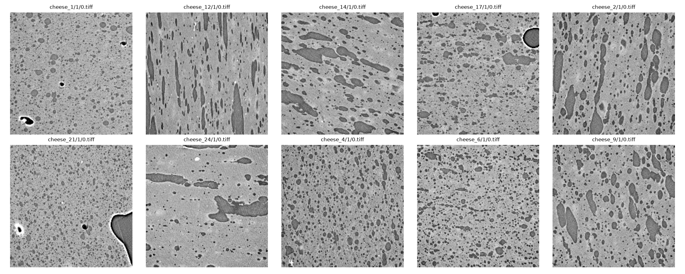
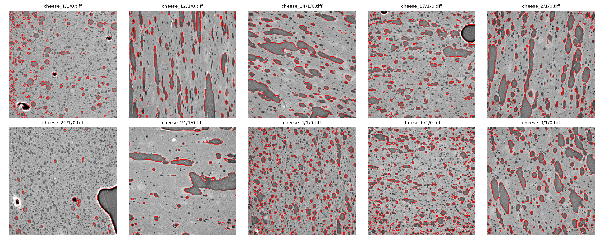
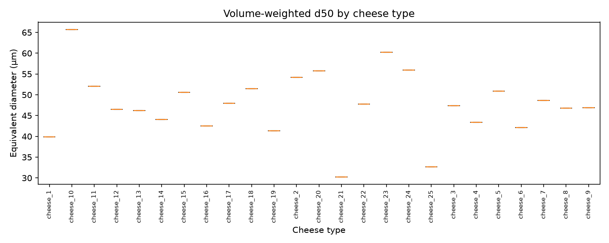
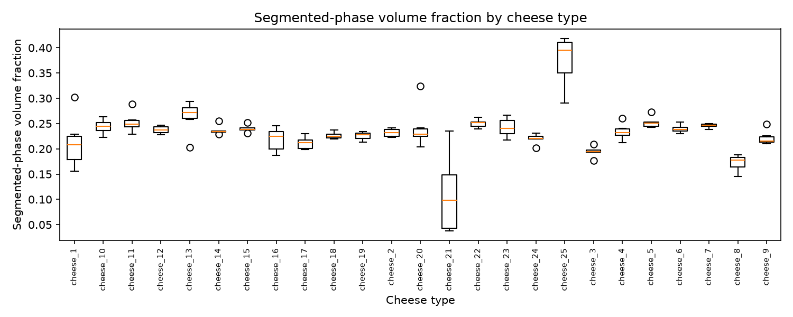
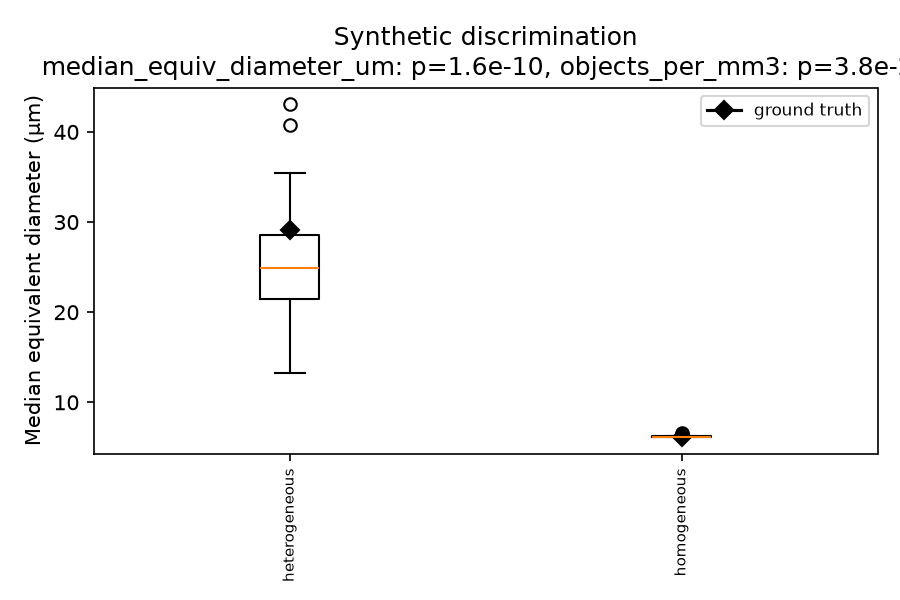

structural analysis of different cheese types using imageJ on the MozzaVID dataset

- Samples summarised: 149
- Voxel size: 4.4 µm (0.55 µm raw × 8 downscale; isotropic, verified)
- Gaussian sigma: 1.5 voxels (6.6 µm)
- Min object size: 50 voxels (4259 µm³)
- Threshold: otsu, invert=True
